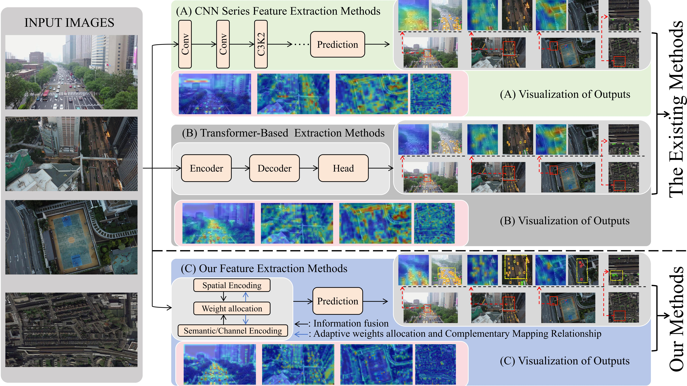
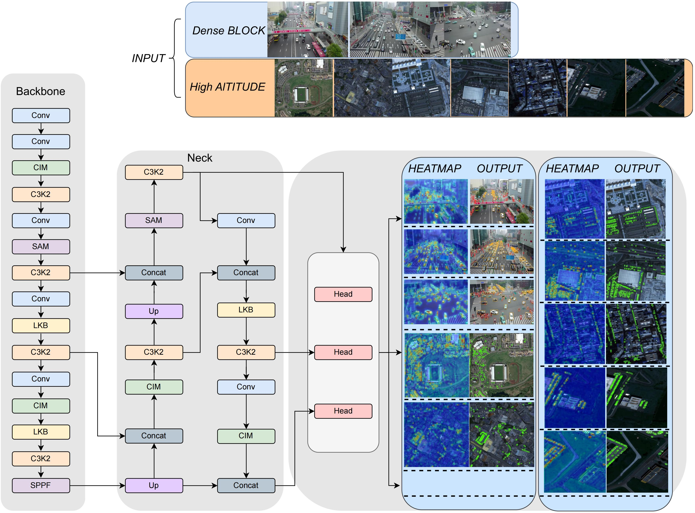
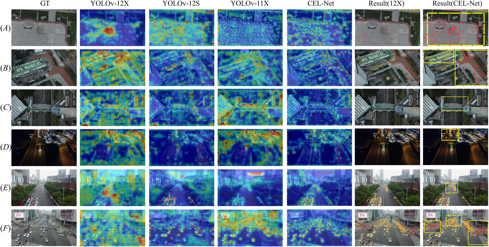
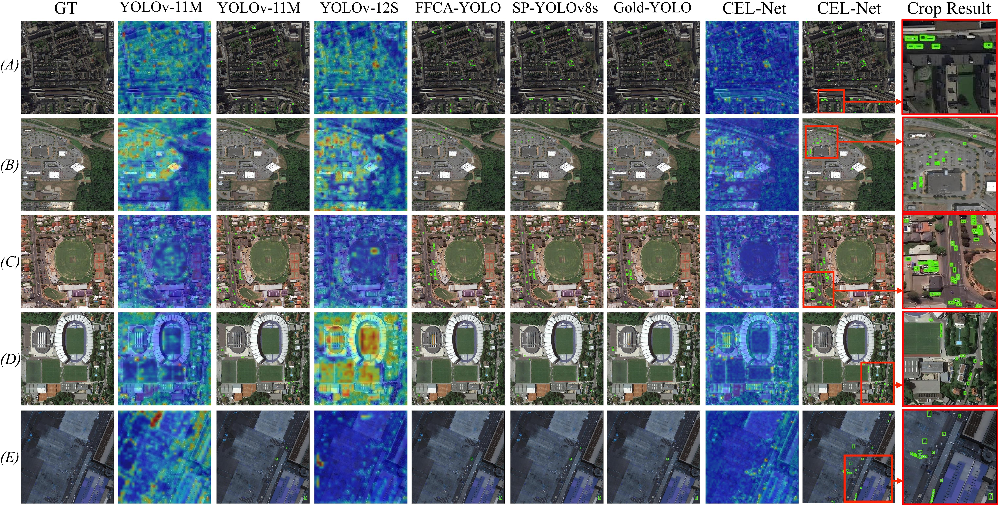
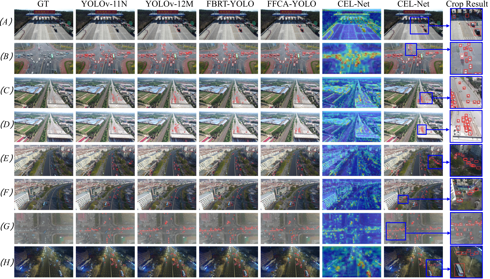

# CEL-Net

Code repository for **CEL-Net: Cross-Scale and Edge-Aware Representation Learning for Aerial Small Object Detection**.

The paper presents CEL-Net, a computationally efficient detector for aerial small objects. It coordinates cross-scale feature interaction, position-guided foreground selection, and edge-aware structural refinement, and is evaluated on VisDrone, AI-TOD, and UAVDT.

## Overview

- **Cross-Scale Interaction Module (CIM):** balances complementary contextual and detail-oriented feature branches through learnable soft weighting.
- **Spatial Attention Module (SAM):** combines local detail and global context through position-guided weighting to suppress background interference.
- **Edge-enhanced Large Kernel Border (ELKB):** combines large-kernel context with boundary-sensitive feature refinement.
- **Auxiliary supervision:** the paper uses annotation-derived edge, attention, and cross-scale losses during training, with coefficients of 0.3 for each enabled term.

### Motivation



### Architecture



## Qualitative Results

### VisDrone



### AI-TOD



### UAVDT



## Results Reported in the Paper

Detection metrics are percentages. Entries with uncertainty are mean +/- standard deviation across three independent training runs. GPU FPS is measured on a single RTX 4090 with 640 x 640 inputs.

| Dataset / evaluation split | Model | mAP50 (%) | mAP50:95 (%) | FPS |
| --- | --- | ---: | ---: | ---: |
| VisDrone / test-dev | CEL-Net-N | 42.3 +/- 1.36 | 24.9 +/- 1.24 | 178 +/- 2 |
| VisDrone / test-dev | CEL-Net-S | 45.8 +/- 1.28 | 27.8 +/- 1.15 | 143 +/- 2 |
| VisDrone / test-dev | CEL-Net-M | 44.0 +/- 1.42 | 27.0 +/- 1.36 | 113 +/- 2 |
| VisDrone / test-dev | CEL-Net-L | 44.6 +/- 1.45 | 26.8 +/- 1.28 | 70 +/- 1 |
| VisDrone / test-dev | CEL-Net-X | 47.3 +/- 1.34 | 31.5 +/- 1.22 | 65 +/- 1 |
| AI-TOD / validation | CEL-Net-S | 56.85 | 28.4 +/- 1.2 | - |
| AI-TOD / validation | CEL-Net-M | 57.63 | 29.2 +/- 1.2 | - |
| UAVDT / test | CEL-Net-N | 29.2 | 16.4 | 120 |
| UAVDT / test | CEL-Net-X | 33.0 | 21.0 | 65 |

The AI-TOD mAP50 entries follow the overall values reported in the manuscript table and are listed without a standard deviation.

On VisDrone, CEL-Net-X improves mAP50:95 and mAP50 over YOLOv-12X by 3.5 and 2.0 percentage points, respectively, while using 122.3G rather than 199.0G FLOPs.

### Model Configurations

The paper reports five model scales for different accuracy and processing requirements.

| Model | Layer depth | Parameters (M) | FLOPs (G) |
| --- | ---: | ---: | ---: |
| CEL-Net-N | 125 | 2.643 | 7.7 |
| CEL-Net-S | 216 | 4.933 | 22.5 |
| CEL-Net-M | 353 | 15.325 | 48.4 |
| CEL-Net-L | 329 | 24.321 | 81.9 |
| CEL-Net-X | 378 | 36.298 | 122.3 |

### Embedded-Device Evaluation

For CEL-Net-N on NVIDIA Jetson Orin Nano at 640 x 640, the paper reports 6.0-6.3 FPS, 158.5-166.8 ms latency, and 480.0-495.0 MB peak memory.

## Repository Structure

```text
CEL-Net/
+-- assert/                         # Figures and qualitative results
+-- results/                        # Example training and validation outputs
+-- ultralytics/
|   +-- cfg/datasets/               # Dataset configuration files
|   +-- cfg/models/CEL-Net/         # Existing model configuration files
|   +-- nn/modules/conv.py          # CIM, SAM, and large-kernel modules
+-- train_model.py                  # Training entry point
+-- requirement.txt                 # Bundled package version list
+-- pyproject.toml                  # Package metadata and dependencies
```

## Installation

Create an isolated environment and install a PyTorch build compatible with your CUDA driver. Then install this repository in editable mode.

```bash
conda create -n celnet python=3.9 -y
conda activate celnet

# Install PyTorch for your CUDA environment first, then:
pip install -e .
```

The bundled package versions are listed in `requirement.txt`.

## Dataset Preparation

The manuscript uses the following training and evaluation partitions:

| Dataset | Training images / frames | Evaluation split | Evaluation images / frames |
| --- | ---: | --- | ---: |
| VisDrone | 6471 | test-dev | 1610 |
| AI-TOD | 11214 | validation | 2804 |
| UAVDT | 23829 | test | 16580 |

Download each dataset from its official source and convert its annotations to YOLO format. Update the `path` field in its dataset YAML and verify the split paths and class mapping before training or evaluation.

```text
dataset_root/
+-- images/
|   +-- train/
|   +-- val/
|   +-- test/                       # For datasets evaluated on a test split
+-- labels/
    +-- train/
    +-- val/
    +-- test/
```

VisDrone and AI-TOD dataset files are located at:

```text
ultralytics/cfg/datasets/VisDrone.yaml
ultralytics/cfg/datasets/AI-TOD.yaml
```

The existing `ultralytics/cfg/datasets/UAVDT.yaml` contains AI-TOD paths and categories; replace those entries with the actual UAVDT dataset configuration before using it.

## Training

The manuscript training setup uses 500 epochs, batch size 32, SGD with momentum 0.937 and weight decay 0.0005, an initial learning rate of 0.01, and cosine decay on two RTX 4090 GPUs.

Example CLI invocation using the existing N configuration:

```bash
yolo detect train \
  model=ultralytics/cfg/models/CEL-Net/CEL-NET-n.yaml \
  data=ultralytics/cfg/datasets/VisDrone.yaml \
  epochs=500 batch=32 imgsz=640 device=0,1 \
  optimizer=SGD lr0=0.01 momentum=0.937 weight_decay=0.0005 cos_lr=True
```

For AI-TOD, select `data=ultralytics/cfg/datasets/AI-TOD.yaml`.

Available configuration files are `CEL-NET-n.yaml`, `CEL-NET-s.yaml`, `CEL-NET-m.yaml`, `CEL-NET-l.yaml`, and `CEL-NET-x.yaml`, corresponding to the CEL-Net-N/S/M/L/X model names in the manuscript.

## Validation and Inference

Evaluate the VisDrone test-dev split used in the manuscript:

```bash
yolo detect val model=path/to/best.pt data=ultralytics/cfg/datasets/VisDrone.yaml split=test imgsz=640 device=0
```

Evaluate the AI-TOD validation split:

```bash
yolo detect val model=path/to/best.pt data=ultralytics/cfg/datasets/AI-TOD.yaml split=val imgsz=640 device=0
```

Run inference on an image or directory:

```bash
yolo detect predict model=path/to/best.pt source=path/to/images imgsz=640 device=0
```

## Notes

- Pretrained weights and datasets are not included.
- Dataset paths and class mappings must be configured before training or evaluation.
- The tables above summarize manuscript results; use the matching final model and training configurations when reproducing a particular paper variant.
- The codebase is built on Ultralytics and distributed under the AGPL-3.0 license.

## Citation

The complete citation will be added when the paper is formally published. Until then, please cite the paper by its full title:

> CEL-Net: Cross-Scale and Edge-Aware Representation Learning for Aerial Small Object Detection
